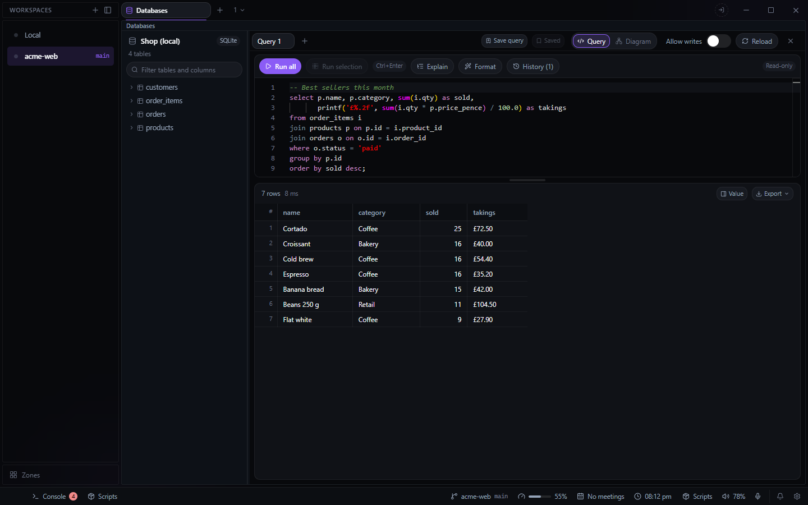

# Databases for Deck

Browse SQLite files, Postgres, MySQL, SQL Server, Redis and MongoDB, and run queries against them.
Open it from the **+** beside your tabs and choose **Databases**.

## Connections

- A SQLite file is opened in place, so with writes allowed, a write is saved to the file. The
  others connect by URL (`postgres://`, `mysql://`, `mssql://`, `redis://`, `mongodb://`).
- **Through SSH:** a connection can go through a host from your `~/.ssh/config`, naming the
  host:port to reach from there, so a database that is not exposed to the internet can still be
  opened without running `ssh -L` yourself.
- **Writes are off** for a new connection: anything that would change the database is refused
  before it is sent. Turn on **Allow writes** per connection.

## Browsing and querying

- **Tables** with their columns and row counts, filtered by name. Right-click a table to show its
  structure, select or count its rows, find a row by primary key, or start an insert, update or
  delete.
- **Structure** shows a table's columns, defaults, foreign keys in and out, indexes and CREATE
  statement. **Diagram** draws every table with lines for its foreign keys; drag the cards around.
- **The query editor** has tabs, completion of table and column names, **Format** (Shift+Alt+F,
  in the engine's own dialect), **Explain**, saved queries per database, and the history of what
  you ran. Ctrl+Enter runs the query, or the selection; it can be rebound in Settings >
  Keybindings. Redis takes command lines and MongoDB takes JSON commands.
- **Results** load 1,000 rows at a time (**Load more** for the next page). Sort by a column, click
  a foreign key to open the row it points at, and read a whole value in the value panel (Space or
  Enter opens it, Ctrl+C copies the picked cell).
- **Export** the rows on screen: copy them as CSV, JSON or INSERT statements, or save them as CSV
  or JSON.
- **Edit in place** where the query reads one table with a key: change a cell, insert a row or
  delete one, with writes allowed.

Connections, query tabs, saved queries and history are kept in Deck's config as `plugin-db`, on
this machine.

## The helper program

Deck opens SQLite, Postgres and MySQL itself. SQL Server, Redis and MongoDB go through a small
helper program, downloaded from this repository's GitHub releases the first time you connect to
one, after asking. It is checked against its pinned SHA-256 and kept in the plugin's own folder.
